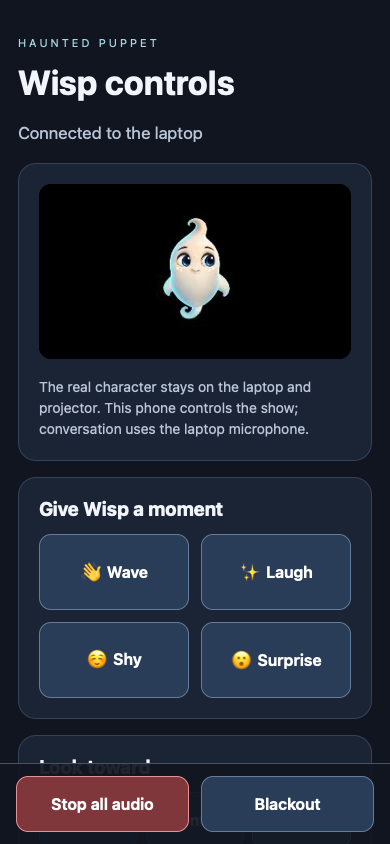

# Haunted Puppet

A painted Wisp character with native voice conversation, a laptop show dashboard, a silent projector view, and a paired phone director.

Hosted desk: https://hauntedpuppet.netlify.app. Hosted phone control uses the paired room described in [Cloud phone control](docs/CLOUD-PHONE.md). The hosted voice backend and operator authentication are described in [Hosted voice setup](docs/CLOUD-VOICE.md). Connecting Netlify does not supply an OpenAI API key; configure the server-side secrets once, redeploy, and sign in as operator.


Wisp's approved 2D artwork stays intact. The character floats, blinks, looks toward visitors, reacts and speaks with mouth shapes drawn from transparent painting layers.

## Run on the laptop

Use Python 3.9+ and a current Chrome browser. Start with:

```sh
python3 server.py
```

Open **http://127.0.0.1:8770/**. On a Mac, `Start.command` also launches the desk. Click **Connect OpenAI securely** and enter the key in the private local dialog. On Mac, it is saved in your Keychain and loaded automatically on future launches. For a development shell, the server also accepts `OPENAI_API_KEY` from its environment; never save it in this repository.

Choose **Native live conversation**, select a voice and microphone, then **Start live conversation**. Marin and Cedar are the initial casting choices. Wisp responds with streamed audio and can be interrupted. **Stop All** releases the microphone and stops every performance; **Blackout** also clears the projected picture.

A clear goodbye finishes a short farewell and returns Wisp to idle loops. The operator chooses whether the microphone stays live for the next visitor. Quiet timeout releases it after inactivity. Local idle animation makes no voice requests.

The OpenAI project must have access to the configured Realtime model. Connection failures are shown at the desk; native conversation is not silently replaced by slower speech.

## Projector and phone

**Open projector** creates a separate silent view. Move it to the projector display, click it, and press **F** for fullscreen. Loss of the laptop controller blanks the output.

Under **Phone remote**, explicitly enable the LAN service. Put the phone on the same trusted Wi-Fi, scan the displayed address, and enter the six-digit pairing code. The phone can direct gestures, gaze, audience, idle loops, prepared moments, volume, Stop and Blackout. The laptop continues to own the microphone and sound.



The local dashboard listens only on loopback port 8770. The optional phone service uses port 8771, paired permissions and a restricted command list. It does not expose provider credentials. This first remote uses HTTP on trusted local Wi-Fi; it is not an internet-facing deployment. Disable it or revoke phones from the laptop when finished.

## Prepared performances and art

Included rehearsal and show cues work offline. Preparing new spoken lines uses OpenAI and can retain forced phoneme timing. Install the optional English aligner with `python3 -m pip install -r requirements.txt` or use `Setup Alignment.command` on Mac.

Native streaming mouth motion is an acoustic estimate driven by the audible signal. It is not phoneme recognition. The first character is friendly Wisp; evil artwork and a painted transformation sequence remain future production assets.

## Development and tests

Use Node 22+ for browser tests:

```sh
npm ci
npx playwright install chromium
python3 server.py
# In another terminal:
npm test
```

Tests cover painting integrity, mouth/expression combinations, stop and late-response cancellation, silent projector sync, native WebRTC lifecycle with a local simulated peer, phone pairing/control/revocation and automated accessibility checks. CI runs without an OpenAI key. A simulated peer checks browser media and state behavior; it does not prove provider access or physical microphone performance.

Genuine provider results, device rehearsal limits and remaining production work are recorded in the test evidence and production roadmap. Do a real speaker/microphone rehearsal in the venue before a show.

## Project map

- `server.py`, `realtime_voice.py`: local server, trusted native session creation and cleanup.
- `app.js`, `assets/painted-wisp.js`: character renderer, shared audio clock and silent projector sync.
- `assets/realtime-voice.js`, `assets/show-controls.js`: streaming conversation, encounter lifecycle and director controls.
- `phone_bridge.py`, `phone_remote/`, `assets/phone-bridge.js`: optional paired phone director.
- `assets/wisp/`: approved registered paintings, pivots, masks and integrity checks.
- `docs/`: production roadmap and evaluated open-source components.
- `tests/`, `.github/workflows/`: local and CI regressions.

Third-party licenses are retained with their components. Original character art and application code are not automatically relicensed by this public repository. See `ASSET-SOURCES.md` and `docs/OPEN-SOURCE-COMPONENTS.md` for provenance.

## Projection studio and authored moments

Open **Projection studio** to fit Wisp to a physical sheet, window, or portrait frame. Drag the four corners or use arrow keys; Shift + arrow adjusts faster. Exact planar perspective keeps lines straight. Choose brightness, soft edges and an optional oval mask, then save or export the surface. The alignment pattern is for setup only and is suppressed by Blackout. A lost operator desk blanks the projector.

**Enchanted mansion** adds the original painted window scenery. **Floating Wisp** keeps the backdrop pure black. Scenery does not replace or recolor the approved character artwork. Three authored stories combine existing recorded cues, gaze and gentle gestures; they stop on operator takeover and return to waiting.

The built-in mapper currently calibrates one planar surface. It does not solve a room from a camera, drive multiple independently mapped characters, or perform multi-projector edge blending. The [immersive production research](docs/IMMERSIVE-PRODUCTION-RESEARCH.md) describes the next systems and researched libraries, with licenses and integration limits.
